<h1 align="center">
  <a href="https://benitdev.github.io/bencode/">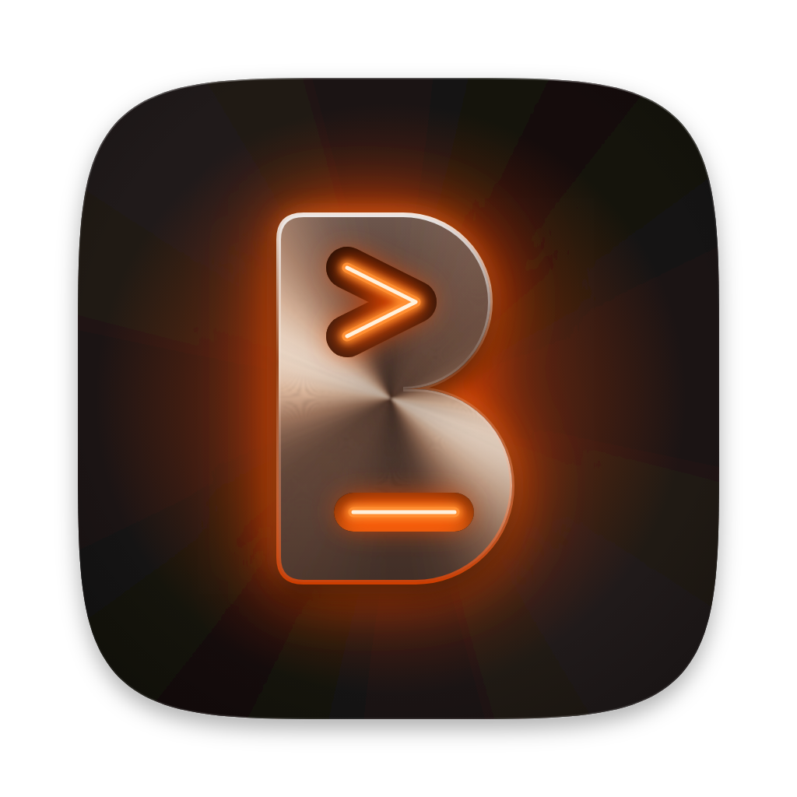</a> BenCode
</h1>

<p align="center">
  <a href="https://github.com/Benitdev/bencode/stargazers"></a>
  <a href="https://github.com/Benitdev/bencode/releases/latest"></a>
  <a href="https://github.com/Benitdev/bencode/releases"></a>
  
  
  
</p>

<p align="center">
  <sub><b>English</b> · <a href="docs/readme/README.vi.md">Tiếng Việt</a></sub>
</p>

<p align="center">
  <strong>Every coding agent, one native window.</strong><br/>
  Run Claude Code, Codex, Antigravity, Grok Build and OpenCode side by side, with your files, git, terminal and inbox around them.<br/>
  No Electron: the whole app is drawn on the GPU, and the only web view is the in-app browser's page.
</p>

<h3 align="center"><a href="https://github.com/Benitdev/bencode/releases/latest/download/BenCode-arm64.dmg"><ins>Download for Apple Silicon</ins></a> · <a href="https://github.com/Benitdev/bencode/releases/latest/download/BenCode-x86_64.dmg"><ins>Intel</ins></a></h3>

<p align="center">
  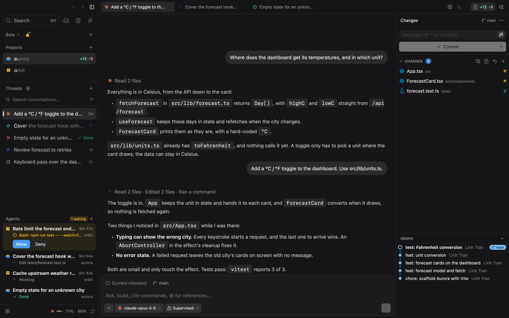
</p>

## Features

<table>
<tr>
<td width="50%" valign="middle">

### Agents side by side

One thread per task, each with its own agent, model and permission mode. Split the chat (⌘D), queue follow-ups, stop a turn, or hand a thread off to another agent. The **Agents** section under the navigator's threads follows every turn in flight across projects, and lets you Allow or Deny a waiting command without leaving the thread you are in.

</td>
<td width="50%">
  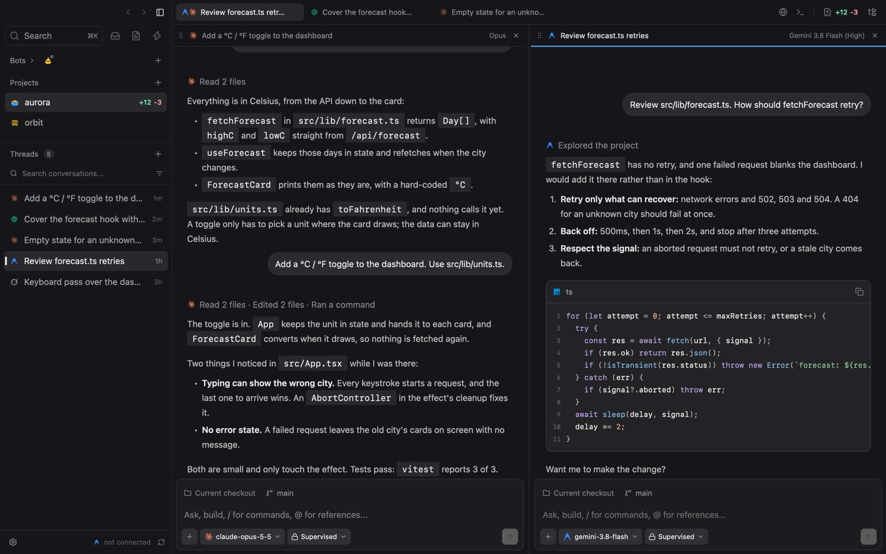
</td>
</tr>
<tr>
<td width="50%" valign="middle">

### Every agent, every model

Pick the harness, model, effort and permission mode for each thread right from the composer (⌘.). BenCode drives the CLIs you already have over stdio and adds no API keys and no token cost of its own.

</td>
<td width="50%">
  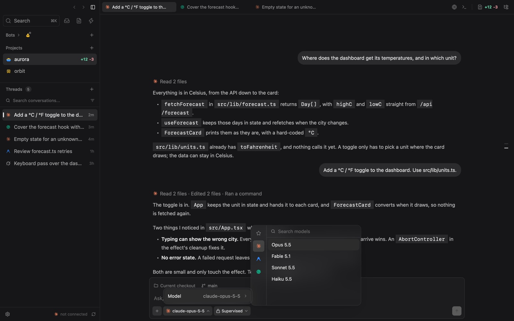
</td>
</tr>
<tr>
<td width="50%" valign="middle">

### Approve each step

In **Supervised** mode every file write and shell command waits for you in the transcript, with the exact path or command: Allow or Deny, then the agent carries on.

</td>
<td width="50%">
  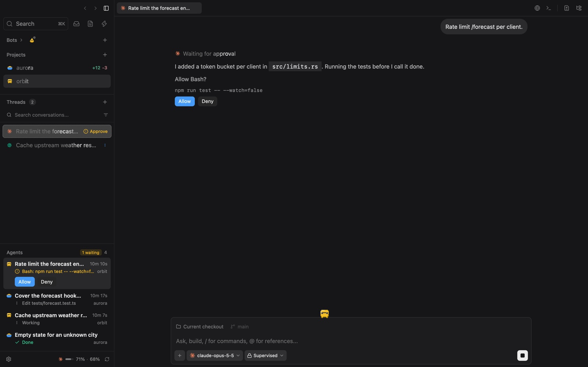
</td>
</tr>
<tr>
<td width="50%" valign="middle">

### Review every turn

A turn that edits files ends with a **Changed N files** card. Undo it, Keep it, or Review exactly what that thread changed: stacked files, sticky headers, folded context.

</td>
<td width="50%">
  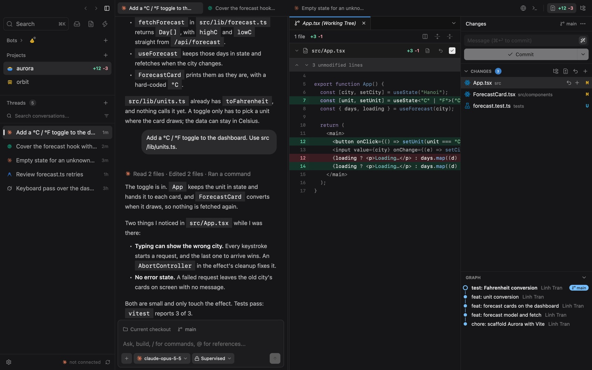
</td>
</tr>
<tr>
<td width="50%" valign="middle">

### Git built in

Stage, discard and commit from Changes in the inspector (⌃⇧G), with a generated commit message if you like. Fetch, pull, push, open a pull request, browse the commit graph and work in worktrees without leaving the chat. A pill under a settled thread asks its agent to stage, commit or push only the files it changed.

</td>
<td width="50%">
  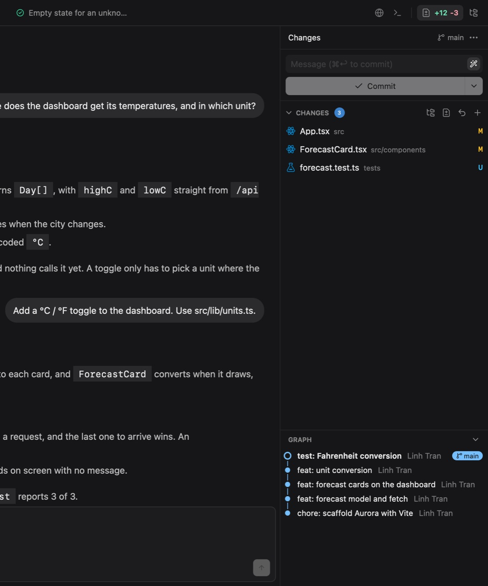
</td>
</tr>
<tr>
<td width="50%" valign="middle">

### Files, editor and terminal

An Explorer with Material file icons, a native code editor that notices when an agent changes the file under you, Go to File (⌘P), search in files (⇧⌘F), Go to Definition (⌘-click or F12) with no language server, line blame and File History (⌥⌘H). A terminal per project (⌘J) splits side by side, and its shells outlive an update's restart or a crash.

</td>
<td width="50%">
  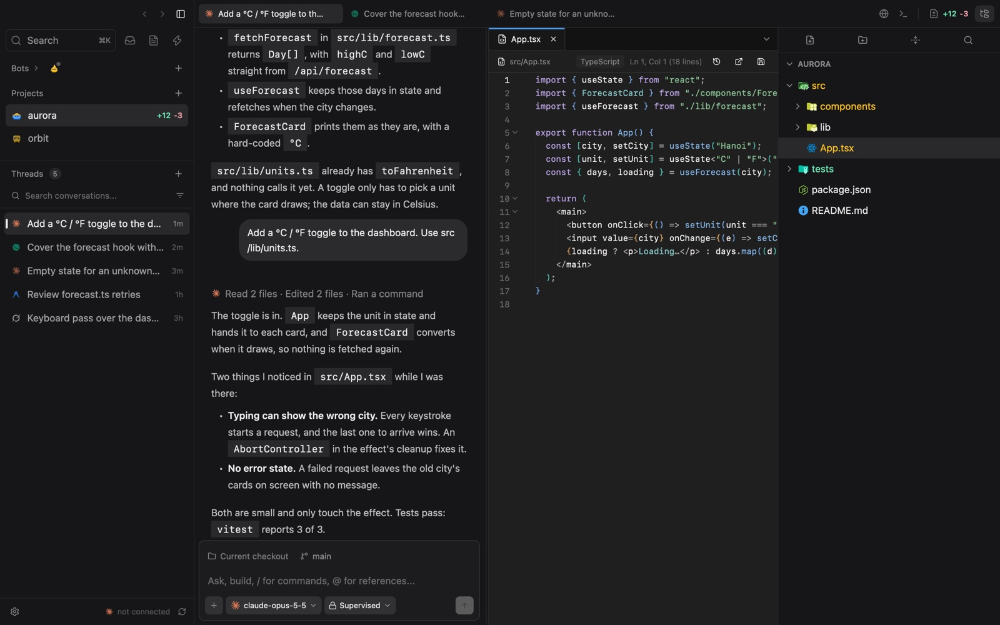
</td>
</tr>
<tr>
<td width="50%" valign="middle">

### Notes

Markdown notes with tags and a project, Preview and Source, dropped images and autosave. **Add to chat** hands a note to the agent as context.

</td>
<td width="50%">
  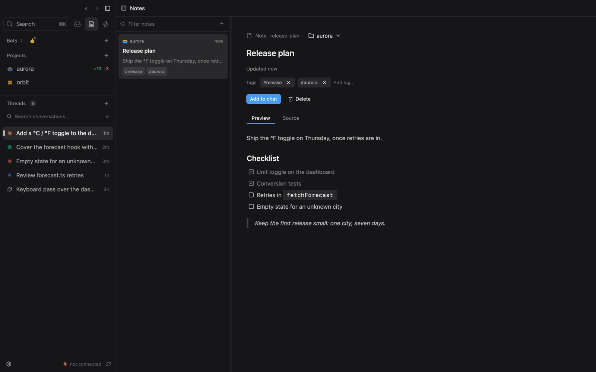
</td>
</tr>
<tr>
<td width="50%" valign="middle">

### Automations

Scheduled prompts, from a template or from scratch: pick the triggers, the model and the permission mode, and run in the repository or a fresh worktree. An overview shows what is running, what needs you, recent results and what comes next. Skip one run, pause everything until a date, or test unsaved edits.

</td>
<td width="50%">
  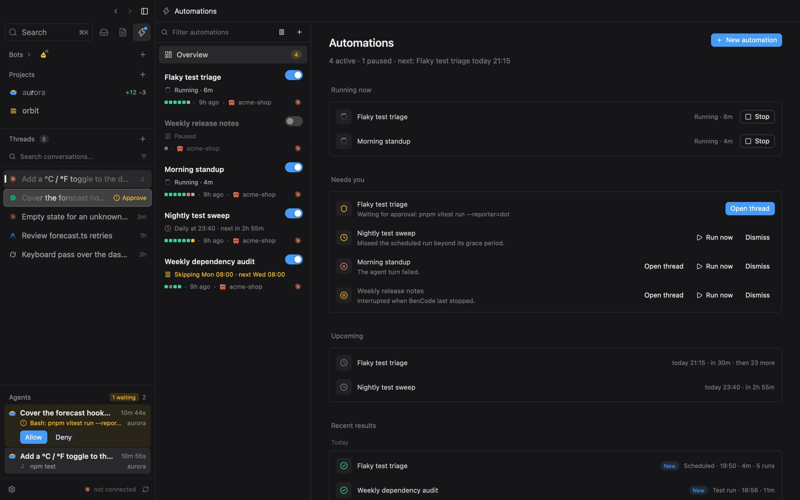
</td>
</tr>
<tr>
<td width="50%" valign="middle">

### Inbox

GitHub issues and pull requests through `gh`, Nulab Backlog issues through an API key, in one list that works from the keyboard and pins what needs you. Send an issue to an agent, several at once in their own worktrees, or ask for a pull request's review; each thread stays linked to its item and shows its state on the row. Translate a ticket in place with your own model.

</td>
<td width="50%">
  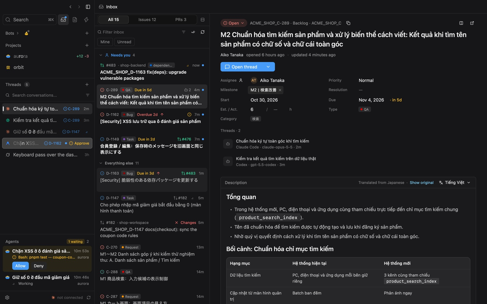
</td>
</tr>
<tr>
<td width="50%" valign="middle">

### Bots

Agents of your own that keep a soul and a memory and look after your projects. Hand one something big: it splits the work on a board, runs each task in a session of its own and reviews what comes back. Habits run on a schedule, a digest lists what waits on you, and ⌥Space brings a bot's floating chat over any app.

</td>
<td width="50%">
  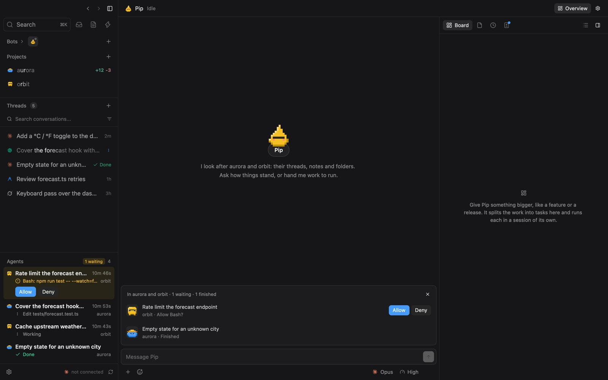
</td>
</tr>
</table>

**Also in the box:**

- **In-app browser (⇧⌘O):** a page in a tab beside the chat. Pick an element or take a screenshot for the composer, and agents can drive the page through an MCP server while a tab is open.
- **Machines:** run agents on another Mac or Linux machine over SSH, with its threads, files, git and terminal in the same window. A turn goes on when the connection drops or BenCode quits ([remote access](docs/remote-access.md)).
- **Inbox extras:** checks, comments, merge and asking an agent to fix CI on GitHub, each project with its own `gh` account; fields, status and comments edited in place on Backlog.
- **Accounts and usage:** several Claude Code and Codex accounts, each thread pinned to one, with 5-hour, weekly and monthly usage at the foot of the navigator. A thread stopped by a usage limit can carry on as another account. Switch between saved Antigravity sign-ins.
- **Sessions from outside:** Settings › Providers › Import sessions brings in what you ran in Claude Code or Codex as threads you can resume.
- **Composer:** `@` to mention files and notes, `/` for skills and `/mcp`, attachments, editing and resending the last prompt.
- **Search (⌘K)** across threads, files and projects; **find in conversation (⌘F)** and a prompt outline. Replies draw Mermaid diagrams and math.
- **Organise:** thread folders, pins, archive, reminders, and opening the project in VS Code, Cursor, Zed and others.
- **Alerts:** sounds and macOS notifications for finished turns, approvals, questions and reminders.
- **Updates itself** from GitHub Releases: the navigator shows **Update to X**, or use **BenCode › Check for Updates…**

---

## Supported agents

BenCode drives the agent CLIs over stdio and reads what they stream: JSON lines, or ACP for Grok Build. Claude Code, Codex, OpenCode and Grok Build are checked against their latest releases and updated from BenCode.

<p>
  <a href="https://docs.anthropic.com/en/docs/claude-code"><kbd> Claude Code</kbd></a> &nbsp;
  <a href="https://github.com/openai/codex"><kbd> Codex</kbd></a> &nbsp;
  <a href="https://antigravity.google/"><kbd> Antigravity</kbd></a> &nbsp;
  <a href="https://x.ai/cli"><kbd> Grok Build</kbd></a> &nbsp;
  <a href="https://opencode.ai/"><kbd> OpenCode</kbd></a>
</p>

## Why native

|  |  |
| :--- | :--- |
| **No browser engine** | Rust and Zed's [GPUI](https://www.gpui.rs/) with BenCode's own components (`crates/bencode-ui`, adapted from [Ely GPUI Components](https://git.zacharyzhang.com/ZacharyZhang-NY/Ely-GPUI-Components)). No Electron, no Chromium; Metal draws the app. The one web view is the page in an in-app browser tab or a bot's visual artifact. |
| **Fast and small** | The targets are a sub-50ms start and about 30MB of RAM. |
| **Local-first** | Threads, notes, checkpoints and account profiles stay on your Mac, in BenCode's own folder. |
| **No extra cost** | BenCode adds no API keys and no tokens. It runs the CLIs you are already signed in to. |

BenCode began as a native port of [MonoCode](https://github.com/hardbeat920/monocode) (Tauri + React) and keeps its database schema, so a MonoCode install's threads come along; from here it goes its own way.

---

## Install

1. Download the build for your Mac (macOS 11 or later):
   [`BenCode-arm64.dmg`](https://github.com/Benitdev/bencode/releases/latest/download/BenCode-arm64.dmg)
   for Apple Silicon (M1 and later), or
   [`BenCode-x86_64.dmg`](https://github.com/Benitdev/bencode/releases/latest/download/BenCode-x86_64.dmg)
   for Intel. All builds are on the [releases page](https://github.com/Benitdev/bencode/releases).
2. Open it and drag **BenCode** into **Applications**.
3. The build is not notarized by Apple yet, so macOS asks for confirmation on
   first launch: open BenCode once, then go to **System Settings › Privacy &
   Security › Open Anyway**. If macOS says the app "is damaged", run:

   ```bash
   xattr -dr com.apple.quarantine /Applications/BenCode.app
   ```

After that BenCode keeps itself up to date.

### Requirements

- **macOS 11** or later.
- **git** on your `PATH`.
- At least one agent CLI, installed and signed in: `claude`, `codex`, `agy`, `grok` or `opencode`.
- Optional: **`gh`** (the GitHub CLI) for the Inbox and pull requests; **`ssh`** for machines.

Hit a problem? **Help › Show Logs** opens the log file so you can attach it to
an [issue](https://github.com/Benitdev/bencode/issues).

<details>
<summary><b>Keyboard shortcuts</b></summary>

| Key | Action |
| :--- | :--- |
| ⌘T | New thread |
| ⌘O | Open project |
| ⌘K | Search |
| ⌘P | Go to File |
| ⇧⌘F | Search in files |
| ⌘F / ⌘G / ⇧⌘G | Find in conversation / next / previous match |
| F12 / ⌥⌘H | Go to Definition / File History |
| ⌘. | Switch model |
| ⌘S | Save the open file |
| ⌘W | Close the file pane's tab (when that pane has focus), otherwise close the thread |
| ⌘B / ⇧⌘B | Toggle the navigator / inspector |
| ⇧⌘E / ⌃⇧G | Explorer / Changes in the inspector |
| ⌥⌘A | Next agent, those waiting on you first |
| ⌘I / ⇧⌘I | Toggle the last bot / ask a bot about this thread |
| ⌥Space | A bot's floating chat, from any app (Settings › Bots) |
| ⇧⌘O | Open a browser tab |
| ⌥⌘S | Swap the chat and the file pane |
| ⌘J / ⌘` | Toggle the terminal / new terminal |
| ⌘D / ⇧⌘D | Split the pane right / down |
| ⌥⌘←→↑↓ | Move focus between panes |
| ⇧⌘] / ⇧⌘[ | Next / previous tab |
| ⌘] / ⌘[ | Forward / back through tab history |
| ⌘, | Settings |
| Esc | Close the open view |

Every shortcut and menu is declared in `src/app/commands.rs`.

</details>

<details>
<summary><b>Where your data lives</b></summary>

| Data | Path |
| :--- | :--- |
| Threads, blocks, notes, automations, reminders | `~/Library/Application Support/BenCode/bencode.db` |
| BenCode's own settings | `~/Library/Application Support/BenCode/settings.json` |
| Checkpoints for reviewing and undoing an agent's changes | `~/Library/Application Support/BenCode/checkpoints` |
| Each provider account's config directory | `~/Library/Application Support/BenCode/provider-accounts` |
| Each bot's soul, memory and board | `~/Library/Application Support/BenCode/monos` |
| Images dropped into notes | `~/Library/Application Support/BenCode/note-assets` |
| Logs (when not run from a terminal) | `~/Library/Logs/BenCode/bencode.log` |

BenCode shares no data with MonoCode. On the very first launch, when there is no
`bencode.db` yet, it copies MonoCode's database, checkpoints and account
profiles (if any) into the folder above, once. MonoCode's files are only read,
never modified.

</details>

---

## Developing

```bash
git clone https://github.com/Benitdev/bencode.git
cd bencode
cargo run
```

You need a recent stable **Rust** (2024 edition) and the Xcode Command Line
Tools. The first build takes a few minutes because GPUI has to compile.

```bash
cargo check                  # fast type check
cargo test                   # unit tests
cargo run                    # run the app
cargo build --release        # optimized build
packaging/macos/bundle.sh    # package BenCode.app and a dmg per architecture (target/bundle)
RUST_LOG=debug cargo run     # turn on logging
RUST_BACKTRACE=1 cargo run   # print a backtrace on panic
```

> [!NOTE]
> `cargo run` opens BenCode's real data (`bencode.db`), just like the installed
> app. Threads, notes and automations you change here are the real ones.

<details>
<summary><b>Architecture</b></summary>

```
bencode/
├── Cargo.toml
├── AGENTS.md            the detailed guide for developers and AI agents
├── CHANGELOG.md         changes in each release
├── assets/              SVG icons (extra Lucide icons, file icons, provider logos)
├── crates/
│   ├── bencode-core/    what the app and its host share: harnesses, file index, search, remote protocol
│   ├── bencode-host/    the daemon on a remote machine
│   └── bencode-ui/      the components, theme and icons
├── docs/code-map.md     where every module lives
├── docs/regions.md      how the window is drawn in parts
├── docs/remote-access.md  machines: connecting, what runs where
├── docs/migration/      what is left open from the MonoCode port
├── docs/releasing.md    how to cut a release
├── packaging/           app icon, Info.plist, the .app / .dmg script, the host's archives
├── scripts/             launch benchmark, bencode-ui's closure
├── site/                landing page (GitHub Pages)
├── tests/fixtures/      recorded CLI output for parser tests
├── vendor/gpui-pre-apple/  GPUI's Metal renderer with the backdrop blur
└── src/
    ├── main.rs          window, theme, keymap
    ├── app.rs           BenCodeApp: the app's state
    ├── app/             logic by concern (agent, panes, workspace, settings…)
    ├── ui/              every view
    ├── db/              BenCode's SQLite database (MonoCode's schema)
    ├── git/             git through the CLI (status, diff, sync, graph, worktrees, checkpoints)
    ├── github.rs        GitHub through `gh`
    ├── backlog.rs       Nulab Backlog through its REST API
    ├── bots.rs, bots/   Bots: souls, memory, habits, boards, figures
    ├── browser/         the in-app browser and its MCP server
    ├── remote/          machines over SSH
    ├── pty_host/        the terminal host, which keeps shells alive
    ├── mcp/, skills/    MCP servers and SKILL.md
    ├── schedule.rs      automation schedules
    └── settings.rs      settings.json
```

How a chat turn flows:

```
prompt ─► app/agent.rs ─► harness::spawn ─► CLI process
                                               │ stdout (JSON lines)
                                               ▼
                               LineParser ─► AgentEvent
                                               │
              transcript ◄── session.blocks ◄──┘──► SQLite
```

A few core principles:

- **No IO in `render()`**, and nothing blocks the UI thread: git, disk and
  SQLite work runs on GPUI's background executor, and views only read a
  snapshot (the `workspace_state` model).
- **Regions are flat, cached views:** a change redraws only the parts of the
  window that show it (`docs/regions.md`).
- **Tokio is for harness processes only**
  (`crates/bencode-core/src/harness/runtime.rs`); GPUI's executor has no Tokio
  reactor.
- **Use `bencode-ui`'s components** (`crates/bencode-ui`) instead of
  hand-rolling them; colours come from `cx.theme().colors`.
- **Preserve data BenCode does not understand** when writing to the database:
  rows copied from MonoCode carry columns BenCode does not use yet.

| Layer | Technology |
| :--- | :--- |
| Language | Rust (2024 edition) |
| UI | Zed's [GPUI](https://www.gpui.rs/) (`gpui-pre` 0.3.10), its Metal renderer vendored |
| Components | `crates/bencode-ui`, adapted from [Ely GPUI Components](https://git.zacharyzhang.com/ZacharyZhang-NY/Ely-GPUI-Components) |
| Database | SQLite via `rusqlite` (bundled) |
| Agent processes | Tokio |
| Time, hashing, JSON | `jiff`, `sha2`, `serde_json` |

</details>

### Contributing

1. Read [`AGENTS.md`](AGENTS.md) before changing code: it has the UI rules and
   the common pitfalls.
2. Check a new feature against the principles in `AGENTS.md`. When MonoCode
   has it, read its source in `reference/monocode` (a symlink, not tracked in
   git) first.
3. Run `cargo test`, then run the app and exercise what you changed. `AGENTS.md`
   explains how to take pictures of the window and measure frame and launch
   cost on a copy of your data.
4. What is open, sorted by those principles, is in
   [`docs/migration/PARITY-BACKLOG.md`](docs/migration/PARITY-BACKLOG.md).

### Releasing

Pushing a `vX.Y.Z` tag (matching the version in `Cargo.toml`) makes GitHub
Actions build `BenCode-arm64.dmg` and `BenCode-x86_64.dmg` and publish a GitHub
Release with that version's [`CHANGELOG.md`](CHANGELOG.md) section. The steps,
and how to turn on signing and notarization once there is an Apple Developer
ID, are in [`docs/releasing.md`](docs/releasing.md).

## License

BenCode is free and open source under the [MIT License](LICENSE). The Lucide
icons in `assets/icons` (ISC) and the Material Icon Theme in
`assets/file-icons` (MIT) keep their own licenses in their folders; provider
logos belong to their respective owners.
